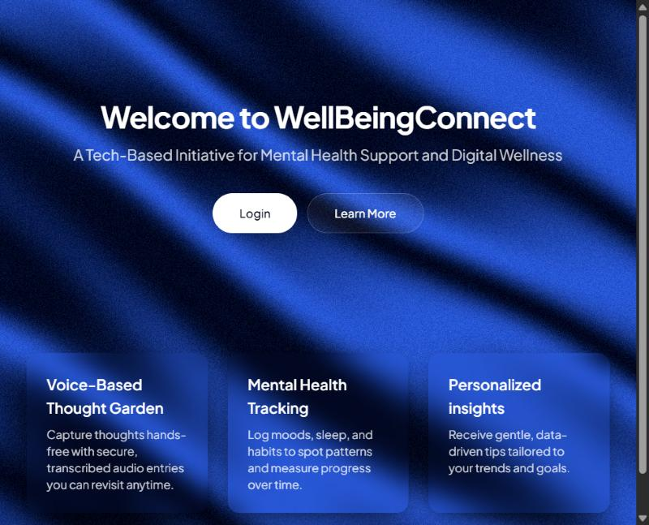

<div align="center">

# 🌿 WellBeingConnect

**A calm, friendly space to look after your mind.**

Talk through your thoughts, track how you feel, learn about mental health
and find a psychologist near you — all in one place.




</div>

---

## ✨ What's inside

| | Feature | What it does |
|---|---|---|
| 🌱 | **Thought Garden** | Speak your thoughts out loud — they turn into text and are checked for mood (positive, neutral or negative). |
| 🏡 | **My Sanctuary** | Your personal dashboard: sleep, stress, energy and focus at a glance, plus a daily quote. |
| 📅 | **My Calendar** | Look back at your moods and Thought Garden entries day by day. |
| ☕ | **The Calm Corner** | Easy reads and research articles on mindfulness, therapy and well-being. |
| 🧑‍⚕️ | **The Expert Network** | Find psychologists near you on a map. |
| 🗓️ | **Bookings** | Book a session in 3 simple steps — details, time slot, confirm — and manage your appointments. |

---

## 🚀 Run it on your computer

You only need **[Node.js](https://nodejs.org)** (version 18 or newer).

```bash
# 1. Download the project
git clone https://github.com/anishatiwari1/WellbeingConnect.git
cd WellbeingConnect

# 2. Install everything
npm install

# 3. Start the app
npm run dev
```

Then open **http://localhost:5173** in your browser. 🎉

> 💡 The first load can take a few seconds — that's normal.

---

## 🗺️ Google Maps (optional)

The Expert Network works **right away in demo mode** with sample psychologists.

Want real places instead? Follow the short guide in
[`GOOGLE_MAPS_SETUP.md`](GOOGLE_MAPS_SETUP.md).

---

## 🛠️ Built with

- **React + TypeScript** — the app itself
- **Vite** — fast development server
- **Tailwind CSS + shadcn/ui** — clean, calm design
- **Web Speech API** — turns your voice into text
- **Sentiment** — understands the mood of your words
- **Google Maps API** — finds experts near you
- **Three.js** — the soft animated background

---

## 📁 Project folders

```
src/
├── pages/        → each screen of the app
├── components/   → reusable building blocks
├── services/     → booking and maps logic
├── context/      → login state
└── hooks/        → small helpers (like the daily quote)
```

---

## 🔒 A note on privacy

Your account and journal entries are saved **only in your own browser**,
on your own device.

---

<div align="center">

Made with 💙 to make mental health support a little easier to reach.

</div>
